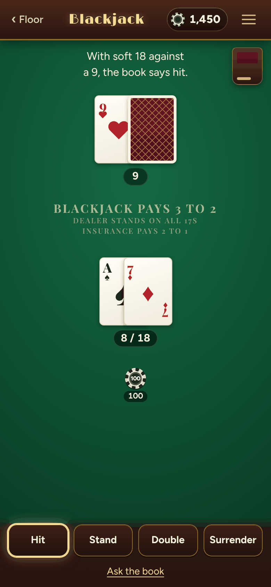
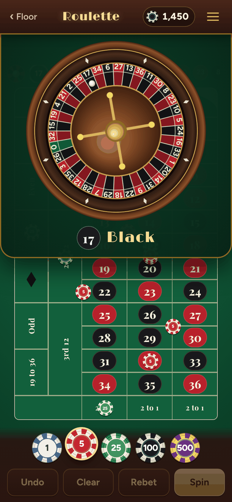
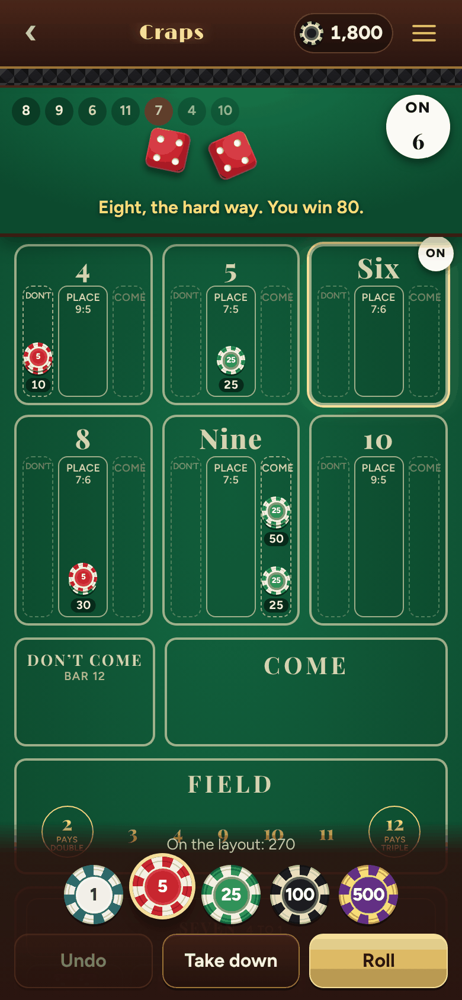
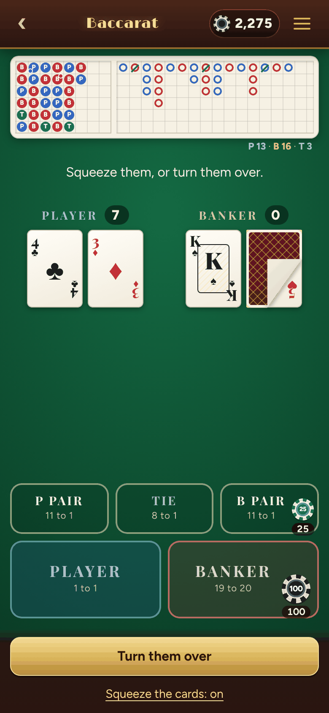
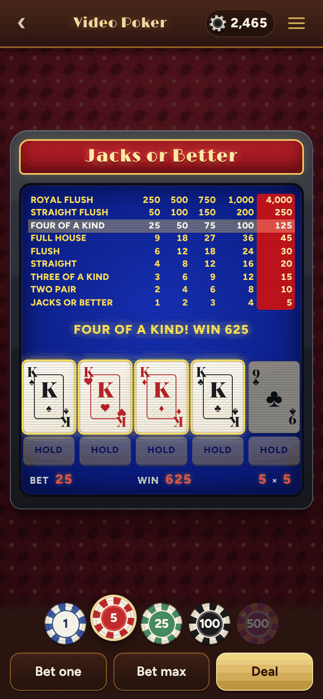
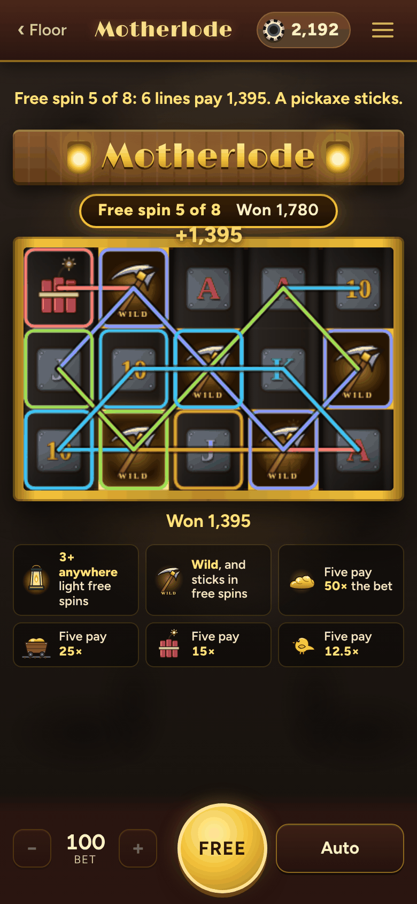
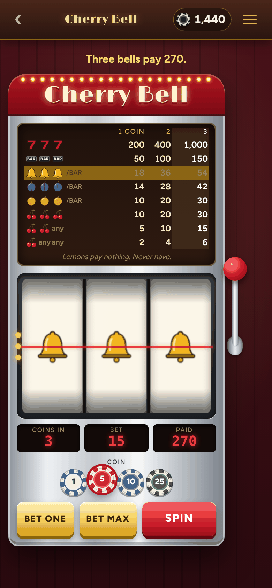
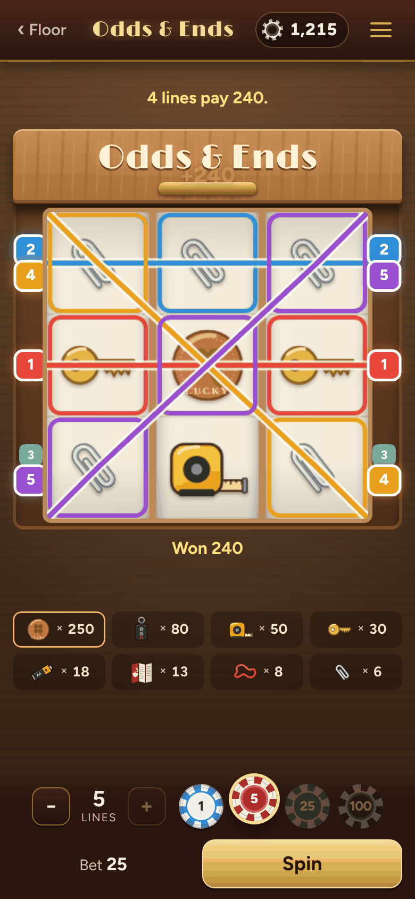

# House Money

**Play it: [house-money.junkdrawer.works](https://house-money.junkdrawer.works/)**

**A casino on your phone, played with chips that cost nothing.** Walk onto the floor and sit down: Blackjack, Roulette, Craps and Baccarat at the tables, and Video Poker and three slot machines (Cherry Bell, Odds & Ends and Motherlode) along the wall. Every table plays from the same stack of chips. Nothing here costs money or pays any, and when you run dry the cage stakes you another 1,000.

<p align="center">
  
  &nbsp;
  
  &nbsp;
  
</p>
<p align="center">
  
  &nbsp;
  
  &nbsp;
  
</p>
<p align="center">
  
  &nbsp;
  
</p>

## How it plays

- **One stack of chips.** You start with 1,000. Chips come off your stack when they go down on the felt and come back when you pick them up or win, at every table, and in every open tab.
- **The cage.** When you're down to less than 10 chips, or less than this table's smallest bet, with nothing left out on a table and no free spins waiting at Motherlode, the cage offers another 1,000: on the floor, and at whatever table you're at. It's all house money anyway. The records count how often it's staked you.
- **The player's card.** Every chip you bet counts on your card, and the card raises the limits at every table: Red to start, Silver from 10,000 bet (limits ×2), Gold from 50,000 (×5) and Black from 250,000 (×10). The floor shows how far you are from the next one. Moving up a card is announced once, at the end of the round that does it, and the floor marks the new card on your next visit.
- **Real odds.** Every game is dealt or spun with the browser's cryptographic randomness and pays what the real game pays, so the house keeps its real edge: about a third of a percent at blackjack played by the book, 2.7% at roulette, 1.4% on the pass line, 1.06% on the banker. The slot machines say what they pay back.
- **Pick up where you left off.** A hand, a spin or a roll is settled the moment it's dealt and saved before the cards or the reels move, so closing the page mid-hand never loses a bet or pays one twice. Bets left on a craps layout stay there, and the floor and Records say what’s still out and where. A table open in two tabs plays in the one opened last; the other waits under a note with a **Play here** button, so a bet can't be lost or a hand paid twice between them.
- **The menu** at every table (☰) says how to play it and what the limits are on your card, and has the way back to the floor, the records, the sound switch and Quick play. The first time you sit down at a table it opens by itself.
- **Records.** Each table keeps your rounds, chips bet, how far up or down you are and your biggest single win, with the day it came, and a few counters of its own (blackjacks, royal flushes, jackpots). **Records** on the floor shows them all, with the most you've ever held.
- **Sound.** Chips, cards, dice, the roulette ball and the reels, all made on the spot with Web Audio: the reels whir softly while they turn, with a low note rising while the last ones spin on for a big win, and winnings tick as they count up. One switch for the whole floor.
- **Quick play.** One switch beside Sound, on the floor and in every table's menu, for long sittings: the roulette wheel spins for a moment instead of ten seconds (about 2.5 s from Spin to the next bet), the slot reels stop half as far apart, the dice fly faster and the dealing doesn't linger. Every result is settled and saved before its animation starts, so it only changes the drawing. It starts off.
- No account and no server. Your chips and records stay in your browser, unless you save them to your own Google Drive (below). It works offline and installs to a phone's home screen as one app; a long press on the icon goes straight to a table.

## Blackjack

Six decks, dealer stands on all 17s, blackjack pays 3 to 2.

- **Bet** by picking a chip from the rack and tapping the circle. Clear picks the chips back up, Rebet puts down your last bet, and after a hand, Same bet deals again straight away.
- **Hit, Stand, Double, Split, Surrender.** Double on any first two cards, and after a split. Split up to four hands; split aces get one card each. Late surrender gives back half the bet. Insurance is offered under a dealer's ace, and with a blackjack on an even bet it's even money (the book never takes either).
- **No lost half chips.** On an odd bet, the half chip a blackjack or a surrender owes you is kept and paid with the next one: a blackjack on 25 pays 37 and keeps the half, and the next one pays 38. It's saved with the hand, so a reload neither pays it twice nor loses it.
- **The dealer peeks** under an ace or a ten for blackjack, so you never lose a double or a split to a blackjack the dealer already had.
- **Ask the book** says what basic strategy does with your hand against the dealer's card, and lights the button: "With soft 18 against a 9, the book says hit." When your rack can't cover a double or a split, it plays the hand without one and says so. Played by the book, this game gives the house about a third of a percent.
- **The shoe** in the corner runs down as it's dealt, and a fresh one is shuffled once the cut card comes out, about three quarters of the way in.
- **Keyboard:** H, S, D, P (split), R (surrender), and Enter to deal.

## Roulette

A single-zero wheel and the whole layout, standing upright on a phone: 0 at the top, 1 to 36 in rows of three, the columns' 2 to 1 at the bottom, and the dozens and even-money bets down the left.

- **Tap to bet, slide to adjust.** Pick a chip and press on the layout: the numbers your bet covers light up, and the line above says what the bet is and what it pays. Slide to another bet before you let go. The middle of a number is straight up, the line between two numbers a split, the point where four meet a corner, the left edge of a row a street, and the left edge where two rows meet a six line. Along the zero are the splits with 1, 2 and 3, the two trios and the first four.
- **Press and hold a number** (or right-click it) for a list of every bet that includes it, with what each pays and what's already on it.
- **Undo, Clear, Rebet, Double.** Undo picks up your last chip and Clear picks up all of them. After a spin, Rebet puts the same bets back down, and once they're down the same button doubles them. Bets are 1 to 500 each on a Red card.
- **The spin.** The number is drawn the moment you press Spin, and the spin is settled and saved then. On a phone the wheel slides down over the layout. The ball runs round the track against the wheel's turn, drops off, clicks over the frets and settles in its pocket. On a wide screen the wheel stands beside the layout the whole time. A tap on the wheel while the ball runs drops it straight into its pocket.
- **The payout.** The dolly marks the winning number. Losing bets are swept, and winners light up, show what they won and go back to your rack. Straight up pays 35 to 1, a split 17, a street or trio 11, a corner or the first four 8, a six line 5, a dozen or column 2, and the even-money bets 1. Every bet gives the house the same 1 in 37.
- **The strip** above the layout keeps the last twelve numbers, newest on the left.
- **The keyboard:** Space spins, Backspace undoes, and Tab and Enter put chips on numbers and outside bets.

## Craps

The loudest table in the house, and you're the shooter. Put chips on the layout and press Roll: two red dice tumble across the felt, bounce off the back wall's rubber pyramids, and the stickman calls it.

- **The pass line.** On the come-out, 7 or 11 wins and 2, 3 or 12 loses. Any other number is the point, and the puck turns On over its box. Then the point before a 7 wins, and a 7 is the seven out. A pass bet can't come down once there's a point. On a come-out with nothing on the line (your first roll, after a seven out or a point made), the layout brings the pass line up to sit just above the rack.
- **Odds with no house edge.** Behind the pass line, odds pay true odds: 2 to 1 on 4 and 10, 3 to 2 on 5 and 9, 6 to 5 on 6 and 8. You can bet up to 3×, 4× and 5× your line bet. Don't pass bars the 12, and its lay odds go up to 6×. An amount that doesn't pay in whole chips (5 behind a 5 is owed 7½) pays the whole chips now and keeps the fraction toward your next odds win, so odds and lay odds pay exactly true odds over time.
- **Come and don't come.** Once there's a point, a come bet plays like a new pass line and travels up to the next number rolled. Tap the Come spot in that number's box to put odds on it. Come odds are off on the come-out, and lay odds on a don't come always work.
- **Place bets** pay 9 to 5 on 4 and 10, 7 to 5 on 5 and 9, and 7 to 6 on 6 and 8. They're off on the come-out, and the odd chips are paid down, so a bet that won't pay whole says so as it goes down, and what would: "Five on the 6 pays 5. Make it 6 and it pays 7."
- **The field and the middle.** The field is one roll: 3, 4, 9, 10 and 11 pay even money, 2 pays double and 12 pays triple. The hardways pay 9 to 1 on 6 and 8 and 7 to 1 on 4 and 10, and are off on the come-out. The one-roll bets are Seven at 4 to 1, Any craps at 7 to 1, 3 and 11 at 15 to 1, and 2 and 12 at 30 to 1.
- **Chips.** Winning bets stay up the way a dealer leaves them, and the winnings go to your rack. Undo picks up the last chip you put down. Take down picks up every bet that's allowed to come down, except a don't pass once there's a point and a don't come on its number, with their lay odds (they're at their best there, and can't go back up), and holding a finger on one bet takes down just that one.
- **The pit** stays at the top of the screen while the layout scrolls under it. It shows the last ten rolls, with sevens in red, and the puck. Space or Enter rolls, and Z undoes.

## Baccarat

Punto banco from an eight-deck shoe. Bet on the Player, the Banker or a Tie. The cards and a fixed set of rules decide everything else.

- **Five bets.** Player pays 1 to 1. Banker pays 19 to 20, which is even money less the house's 5%. Tie pays 8 to 1, and Player and Banker bets come back on a tie. Player pair and Banker pair pay 11 to 1 when that hand's first two cards are the same rank.
- **No lost fractions.** The Banker's commission is worked out in twentieths of a chip. Whole chips are paid now and the fraction is kept toward your next Banker win, so the commission comes to exactly 5% over time.
- **The squeeze.** The cards come face down. Drag one from a corner or an edge to peel it back a little at a time, with the peeled part folded over. Let go early and it settles back down; drag far enough and it's turned. A tap turns it over, and **Turn them over** does them all. The squeeze can be switched off under the buttons, and then the dealer turns the cards.
- **Third cards by the tableau.** A natural 8 or 9 stops the coup. Otherwise the Player draws on 0 to 5, and the Banker follows the standard drawing chart. Each third card is dealt face down to squeeze, and it lies sideways the way it does on a real table.
- **The scoreboard.** The bead plate shows every coup in order down the columns, with dots for pairs. The big road shows streaks: a new column when the winner changes, a tail to the right after six, and ties marked across the coup before them. It's kept with the shoe and starts again when the cut card comes out, 16 cards from the end.

## Video Poker

Jacks or Better on a full-pay machine: nine coins for a full house, six for a flush.

- **Coins and coin size.** Pick a coin from the rack, up to your card's limit. **Bet one** steps through one to five coins, and **Bet max** plays five and deals.
- **Hold and draw.** Tap a card or its Hold button to keep it, then Draw replaces the rest from the same shuffled deck. Every hand gets a fresh 52-card deck.
- **The pay table** is lit on the blue screen, with the column for your coins in red. A winning hand's row flashes, and the cards that made it light up. Everything pays the same per coin except the royal flush: 250 a coin, or 4,000 for five coins.
- **The strategy card.** The link under the buttons lights the cards the standard strategy would hold and names the line it comes from (four to a royal, high pair, four to a flush and so on). Played that way the machine returns about 99.5%.
- **Keyboard:** 1 to 5 hold, and Enter deals and draws.

## Cherry Bell

- **An old three-reel fruit machine.** Cherries, lemons, oranges, plums, bells, BARs and red sevens on one pay line across the middle. Pick a coin size, put in one to three coins with Bet one or Bet max, and pull the handle (drag the red ball down) or press Spin. The reels stop left to right with a thunk.
- **The old pay table, printed on the glass.** A BAR on the third reel finishes two bells, plums or oranges. Cherries count from the left: one pays 2, two pay 5. Lemons pay nothing ("Never have"). The winning row flashes, and the coins you're playing light their column.
- **Three coins lift the top prize.** Three sevens pay 200 a coin on one or two coins, and 1,000 on three. If the first two reels show sevens or BARs, the last one spins a moment longer.
- **A virtual reel behind each one.** Every symbol gets so many of 128 chances and the blanks share the rest, so three sevens come about once in 32,768 pulls. It pays back 94.4% on one or two coins and 94.8% on three, and about one pull in four pays.

## Odds & Ends

- **A slot machine stocked from the junk drawer.** Three reels and three rows in the compartments of a drawer organizer: key fobs, tape measures, spare keys, AA batteries, takeout menus, rubber bands and paper clips.
- **The lucky penny is wild.** It stands in for anything, so two keys and a penny pay as three keys. Three pennies pay 250 times the line bet.
- **Five lines:** across the middle, the top and the bottom, and the two diagonals. Play one to five, with a line bet from the chips. Coloured tabs at the sides show which lines are in play, and each winning line is drawn across the drawer, one after another when several pay.
- **A second tap** on Spin or on the drawer while the reels turn lands them at once. The result was picked before they moved, so it only cuts the wait.
- **The long run.** It pays back 95.2% however many lines you play. On all five lines, about one spin in four wins.

## Motherlode

- **Five reels, three rows, twenty lines, down a gold mine.** Gold nuggets, mine carts, dynamite, canaries, and card ranks stamped on iron plates. Three, four or five of a kind pay from the left. The bet is spread over the lines, so it goes up in twenties.
- **The pickaxe is wild** on reels 2 to 5.
- **Lanterns light free spins.** Three, four or five lanterns anywhere pay 2, 10 or 50 times the bet and light 6, 12 or 20 free spins, about once in 135 spins. Two lanterns already showing make the reels after them spin a moment longer.
- **In the free spins the pickaxes stick.** Every pickaxe that lands stays on the glass, framed in gold, until the spins are over, so they pile up. Free spins play by themselves at the bet that lit them, and carry on where they left off if you leave. When they're over, a card adds up what they paid, and the pickaxes come unstuck.
- **Big wins rain coins.** At 15 times the bet it's a Big win, at 40 a Huge win, and at 100 the Motherlode. **Auto** keeps spinning until you tap it again (it says Stop while it runs), the chips run short, or a big win comes in (free spins that pay 15 times the bet count as one). A tap on Spin or the reels while they turn lands them at once, except in the free spins, which play out.
- **The long run.** It pays back about 95.0%, more than a quarter of that from the free spins. About one spin in 2.5 wins.

## Saving to Google Drive

It's optional, and only at [house-money.junkdrawer.works](https://house-money.junkdrawer.works/): the card under the player's card on the floor turns it on, on each phone or computer you play on.

- **What goes in Drive.** One small file in a “House Money” folder in your own Google Drive: the chip stack, the player's card, the cage's stakes, Records, and which tables' how-to-play sheets you've seen. House Money asks only for permission to see the files it makes itself (Google's `drive.file`), so it can't see anything else in your Drive.
- **What stays on each device.** A hand, spin or roll in play, bets left up on the craps layout, Motherlode's free spins, the shoe, the sound switch, Quick play, the chip you last picked at each table, and Baccarat's squeeze switch. Each device does say how many chips it has out on its tables, so another device's cage waits for them before staking you (for a day after that device last synced).
- **How two devices add up.** There's one stack and one starting 1,000. Each device's wins and losses count once, whichever order the devices sync in: a laptop that won 600 on its own and a phone that lost 350 come to 1,250 on both once each has synced. Records and the chips bet on your card always come out exact. The stack does too as long as each device syncs as it opens and as you leave it, which it does by itself whenever it can. A device that plays from an out-of-date stack (offline, or signed out for days) adds its own wins and losses to the shared one when it catches up, which is why the floor's cloud turns red and asks you to tap it before you play. If two devices bet the same chips while apart, the stack stops at 0 rather than going below it, the cage covers the difference and says so once, and its usual offer appears; Records still keep every loss. If two devices both take the cage's 1,000 in the same dry spell, it counts once. (With three or more devices out of touch at once after the cage has covered something, the order they sync in can leave the stack a little higher than one device would have.)
- **When it syncs.** As a page opens, a few seconds after a round (then at most every 30 seconds while you play), when you leave the page and come back, and every 5 minutes. The floor's cloud, and the purse at each table, show a green dot when synced, amber while syncing and red when a tap is needed: Google signs you out after an hour, and one tap signs you back in and syncs. Play never waits for Drive.
- **Your Google account.** The page reads your Google account's email address, to show where it's saving and to make sure a device doesn't save into a different account's Drive.
- **Stopping.** **Stop saving on this device** stops syncing there and keeps the copy in your Drive, for your other devices. To take the permission back altogether, remove junkdrawer.works under Third-party apps & services in your Google Account.
- **Clearing a browser's data** starts that device fresh, with 1,000 chips and empty Records, until Drive is turned back on there; then everything it had saved comes back, nothing is lost, and its fresh 1,000 isn't added.

## Running it

It's a static site: plain HTML, CSS and JavaScript, with no build step. Serve the folder and open it:

```sh
npx http-server -p 8080 -c-1 .
```

GitHub Pages serves `main` at [house-money.junkdrawer.works](https://house-money.junkdrawer.works/) (the `CNAME` file).

- `npm test` runs the unit tests (every payout, the blackjack book, the slot machines' pay-back, the cage, what Records counts, and a long sitting at every table with the books checked after every round) and then drives the real pages in Chromium (`test/e2e.mjs`, needs Playwright): every table opening, the cage's stake, rounds reloaded mid-play, two tabs at one table, that it installs, and every page opening offline. `ONLY=blackjack` runs one table's checks and `PARTIAL=1` skips tables with no page yet. Last, `test/drive.mjs` checks Google Drive saving with two browsers as two devices against a stand-in for Google (`test/fake-google.mjs`, from the junkdrawer kit), looking at what lands in the stand-in's Drive as well as at the pages; `ONLY=3,4` runs some of its checks.
- `node tools/sw-files.mjs` rewrites the offline copy's file list and fingerprint in `sw.js` after a change; the test fails until it's run.
- `node tools/screenshots.mjs [table …]` makes the floor's pictures and the README's phone screenshots, `node tools/og.mjs` makes the link preview (`og.png`), and `node tools/make-icons.mjs` makes the icons.
- `node tools/artifact.mjs` builds the copy that plays in the Artifact viewer, in `dist/artifact/`: links name each folder's `index.html`, and there's no offline copy.

### Files

- `index.html`, `css/floor.css`, `js/floor.js`: the floor.
- `shared/`: what every table uses. `cage.js` (the chips and the player's card), `records.js`, `ledger.js` (how the cage and Records are kept, one section per device, and put together across devices), `sync.js` (saving to Google Drive), `tables.js` (the list of tables, their limits, the most one bet can come to at the machines, and what a round is called at each), `table.js` (the bar, the menu and the cage's offer), `seat.js` (one tab at a time at each table), `chips.js`, `cards.js`, `reels.js` (the slot machines' reels, their arithmetic and each machine's saved spin), `edge-guard.js` (keeps a drag near the screen's edge from turning into the phone's Back), `sound.js`, `casino.css`.
- `blackjack/`, `roulette/`, `craps/`, `baccarat/`, `video-poker/`, `cherry-bell/`, `odds-and-ends/`, `motherlode/`: one folder per table, each with its rules in a file of their own (`js/game.js` and the like) and the page that plays them.
- `records/`: the records page.
- `floor/`: the pictures on the floor's tiles, from `tools/screenshots.mjs`.
- `sw.js`: the offline copy. `manifest.webmanifest` and the icons: installing it.
- `fonts/`: Limelight, Figtree and Playfair Display, served from here so nothing loads from elsewhere (SIL Open Font License).

MIT licensed. See `LICENSE`.
